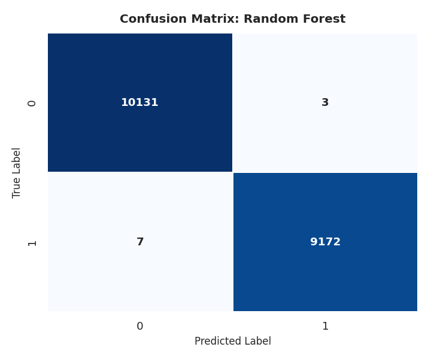
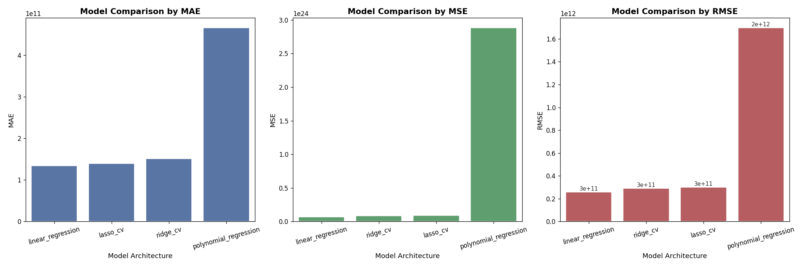

# Supervised Learning: Classification & Regression


Two Python machine learning experiments exploring **customer churn classification** and **GDP regression**, with reusable preprocessing, model comparison, visualizations, and serialized model pipelines.

Originally developed as part of my Ecom School coursework and extracted into a standalone repository with its relevant Git history preserved.

[Experiments](#experiments) · [Visualizations](#visualizations) · [Getting Started](#getting-started) · [Evaluation Notes](#evaluation-notes)

## Experiments

| | Customer churn | GDP regression |
| --- | --- | --- |
| Goal | Predict the `Churn` label from customer attributes | Estimate `GDP` from economic and COVID-19 indicators |
| Inputs | Age, tenure, usage, support calls, payment delay, spending, recent interaction, and subscription details | Year, confirmed cases, deaths, recoveries, unemployment, CPI, and country/region |
| Models | Logistic regression, K-nearest neighbors, support vector machine, random forest | Linear regression, RidgeCV, LassoCV, and a polynomial-feature/Ridge pipeline |
| Metrics | Accuracy, recall, F1 score, confusion matrices | MAE, MSE, RMSE |
| Saved pipeline | Random forest | Linear regression |

Both experiments use a **70/30 training/test split** with `random_state=42`. The classification script uses five-fold cross-validation for logistic regression and grid searches for KNN, SVM, and random forest. The regression script compares ordinary least squares with regularized alternatives.

## Shared Preprocessing

[`utils.py`](utils.py) provides utilities used by both experiments:

- **Numeric features:** median imputation followed by standard scaling.
- **Categorical features:** most-frequent imputation and one-hot encoding, with unseen categories ignored.
- **Composition:** `ColumnTransformer` and `Pipeline` combine preprocessing with estimators.
- **Exploration:** feature correlations and saved heatmaps.
- **Persistence:** complete fitted pipelines saved with joblib, plus CSV files listing input feature names.

The training scripts also normalize missing-value tokens and remove duplicate records. The classification experiment removes customer IDs; the regression experiment converts dates to years and deduplicates country/year records.

## Visualizations

### Churn classification



Confusion matrices are generated for each classifier. Browse the [classification charts](classification_problem/charts/).

### GDP regression



The comparison chart reports MAE, MSE, and RMSE; **lower values are better**. Browse the [regression charts](regression_problem/charts/).

## Getting Started

### 1. Clone the repository

```bash
git clone https://github.com/noname1134/supervised_learning_project_ecom.git
cd supervised_learning_project_ecom
```

### 2. Create a virtual environment

Use **Python 3.10 or newer**.

Linux / macOS:

```bash
python3 -m venv .venv
source .venv/bin/activate
```

Windows PowerShell:

```powershell
py -m venv .venv
.venv\Scripts\Activate.ps1
```

### 3. Install dependencies

```bash
python -m pip install numpy pandas scikit-learn matplotlib seaborn joblib
```

### 4. Run an experiment

Run each script **from its own experiment directory**, because dataset and output paths are relative to the working directory.

Customer churn:

```bash
cd classification_problem
python train.py
```

GDP regression, starting from the repository root:

```bash
cd regression_problem
python train.py
```

Close plot windows to allow execution to continue. For a headless run on Linux / macOS, replace `python train.py` with:

```bash
MPLBACKEND=Agg python train.py
```

Training prints evaluation summaries and model parameters, writes charts to the experiment's `charts/` directory, and overwrites its saved model artifacts. Classification includes several grid searches, so runtime depends on your hardware and dataset size.

## Repository Structure

| Path | Purpose |
| --- | --- |
| [`classification_problem/train.py`](classification_problem/train.py) | Churn model training and evaluation |
| [`regression_problem/train.py`](regression_problem/train.py) | GDP model training and evaluation |
| `classification_problem/data/` | Customer churn CSV dataset |
| `regression_problem/data/` | COVID-19 and GDP CSV dataset |
| `<experiment>/charts/` | Saved visualizations |
| `<experiment>/models/` | Serialized pipelines and input feature-name CSVs |
| [`utils.py`](utils.py) | Shared preprocessing, plotting, training, and export utilities |

## Model Artifacts

- Classification: `classification_problem/models/churn_model.joblib`
- Regression: `regression_problem/models/gdp_model.joblib`

Each exported pipeline is refitted on the full prepared dataset after evaluation. Its preprocessing steps are included in the saved artifact. The export choice is configured through `BEST_MODEL_NAME`; it is not selected automatically from the evaluation ranking.

## Evaluation Notes

This repository contains educational experiments rather than production prediction services.

- Cross-validation currently runs inside the estimator step, after the outer preprocessing step has been fitted on the training split. Cross-validation scores can therefore be optimistic; the held-out test split is evaluated separately.
- GDP evaluation uses a random split of country/year records, rather than a chronological holdout. The results should not be interpreted as validated future GDP forecasting performance.
- The polynomial-feature experiment currently uses `degree=1`, so it does not introduce higher-order polynomial terms.

## Author

[Liad Illouz](https://github.com/noname1134)
